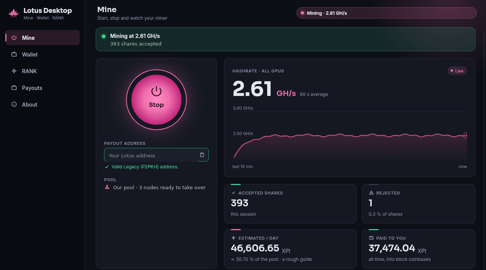
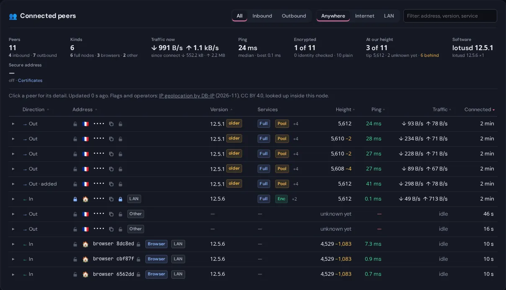
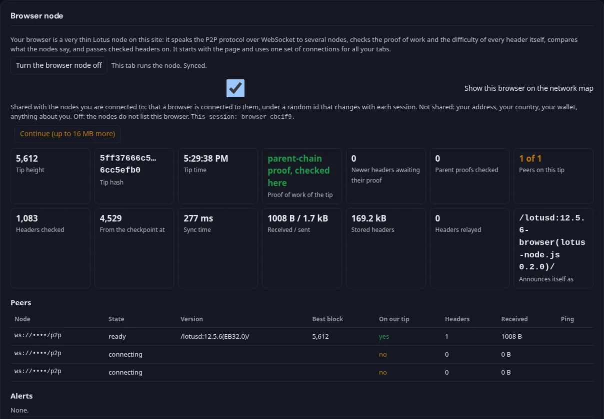
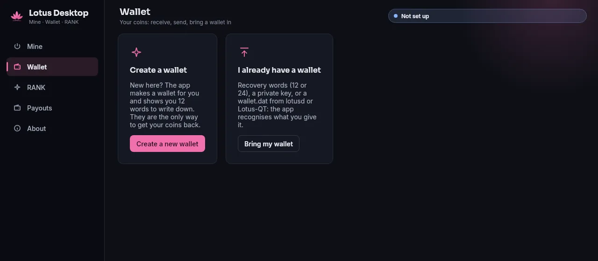
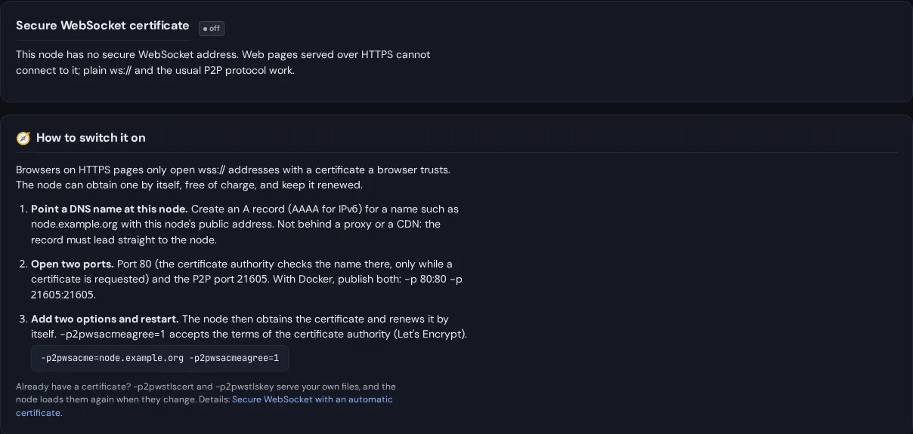

<!-- Generated by render_releases_site.py from data/releases.json at each release. Do not edit by hand: change the template in the source repository. -->
<p align="center">
  
</p>

<h1 align="center">Lotus node releases</h1>

<p align="center">
  <b>lotusd</b>, its tools, the GPU miner and the desktop apps, built and checked by LotusDevOrg.
</p>

<p align="center">
  
  
  
  
  
</p>

<p align="center">
  <a href="https://github.com/LotusDevOrg/lotusd-releases/releases/latest"><b>⬇&nbsp;Download 12.5.6</b></a>
  &nbsp;·&nbsp;<a href="#quick-start">Quick start</a>
  &nbsp;·&nbsp;<a href="https://lotusdevorg.github.io/lotusd-releases/">Release site</a>
  &nbsp;·&nbsp;<a href="https://lotusia.network/">lotusia.network</a>
</p>

Lotus (XPI) is a proof-of-work cryptocurrency with fast blocks, an inflation that pays the miners who secure it, and RANK, a way to give reputation to profiles and posts by burning coins. `lotusd` is the full node: it keeps the chain, checks every block, relays transactions and serves a wallet, an explorer, a mining pool and a web interface. This repository holds its releases only, built from the source by an automated pipeline: the downloads, their checksums and the release notes.

> [!IMPORTANT]
> **Operators: run 12.5.1 or later before 2026-12-21 20:50 UTC.** That is when the Napoleon network upgrade activates new consensus rules on mainnet (median time past of the previous block at or after 1797886200). Earlier versions, 12.4.x included, do not follow the chain after the fork. Until then 12.5.x follows the same rules as 12.4.x, so you can upgrade now. Upgrade guide: [lotusia.network/upgrades](https://lotusia.network/upgrades/).

> [!NOTE]
> **Merged-mining pools, from Napoleon:** Litecoin pools that already merge-mine Lotus with standard AuxPoW need no change. SHA-256d pools (eCash, Bitcoin, Bitcoin Cash) name their chain in one place: `createauxblock <address> xec|btc|bch`, or `-auxpowalgo=<chain>` on the Lotus node. Details: [lotusia.network/napoleon](https://lotusia.network/napoleon/#pools).

## Latest release

<a href="https://github.com/LotusDevOrg/lotusd-releases/releases/tag/v12.5.6"></a>

### [Lotus Root 12.5.6](https://github.com/LotusDevOrg/lotusd-releases/releases/tag/v12.5.6): Encrypted links between nodes, a node in the browser, Lotus Desktop

<sub>Published 22&nbsp;Nov&nbsp;2026 · ready for Napoleon</sub>

Nodes now encrypt the links between them, the node's pages carry a small Lotus node that runs in the visitor's browser, and Lotus Desktop arrives: one app to mine, hold a wallet and vote with RANK.

- **Indexer: a failed rollback could stop block processing; upgrade recommended.**
- **Encrypted connections between nodes.** Two 12.5.6 nodes encrypt the link between them; with an older node the link stays as it was.
- **A Lotus node in the browser.** The node's pages turn the visitor's browser into a small Lotus node that checks block headers itself. The web wallet uses it, and opens Lotus Qt and lotusd wallet files too. One setting lets an operator turn it off for every visitor.
- **Lotus Desktop, first release.** One app to mine with your GPU, hold a wallet and vote with RANK on X (Linux for now). It is also a small peer of the network that checks block headers itself. Your keys stay on your computer: write down the recovery words or save a backup file before you put coins in.
- **Secure WebSocket with automatic certificates**, for operators who turn them on.
- **Pools: a node whose ledger fell out of line repairs itself, and the ASIC proxy pools are the ones the operator lists.**

**[Release page and downloads →](https://github.com/LotusDevOrg/lotusd-releases/releases/tag/v12.5.6)** · [On the release site →](https://lotusdevorg.github.io/lotusd-releases/12.5.6/)

## Downloads

Every file is named `<name>-<version>-<os>-<arch>` (`.tar.gz`, `.zip` for Windows) and listed in `SHA256SUMS`. Version 12.5.6:

| | **Linux x86_64** | **Windows** | **macOS Intel** | **macOS Apple Silicon** | **macOS universal** |
|---|:---:|:---:|:---:|:---:|:---:|
| **Node and tools**<br><sub>the node, `lotus-cli`, `lotus-tx`, `lotus-wallet`, `lotus-seeder`</sub> | [⬇&nbsp;tar.gz](https://github.com/LotusDevOrg/lotusd-releases/releases/download/v12.5.6/lotus-binaries-12.5.6-linux-x86_64.tar.gz)<br><sub>40.7 MB</sub> | [⬇&nbsp;zip](https://github.com/LotusDevOrg/lotusd-releases/releases/download/v12.5.6/lotus-binaries-12.5.6-windows-x86_64.zip)<br><sub>21.8 MB</sub> | [⬇&nbsp;tar.gz](https://github.com/LotusDevOrg/lotusd-releases/releases/download/v12.5.6/lotus-binaries-12.5.6-macos-x86_64.tar.gz)<br><sub>37.4 MB</sub> | — | — |
| **Node only**<br><sub>`lotusd`</sub> | [⬇&nbsp;tar.gz](https://github.com/LotusDevOrg/lotusd-releases/releases/download/v12.5.6/lotusd-12.5.6-linux-x86_64.tar.gz)<br><sub>17.8 MB</sub> | [⬇&nbsp;zip](https://github.com/LotusDevOrg/lotusd-releases/releases/download/v12.5.6/lotusd-12.5.6-windows-x86_64.zip)<br><sub>17.2 MB</sub> | [⬇&nbsp;tar.gz](https://github.com/LotusDevOrg/lotusd-releases/releases/download/v12.5.6/lotusd-12.5.6-macos-x86_64.tar.gz)<br><sub>16.8 MB</sub> | — | — |
| **Lotus Desktop**<br><sub>mine, wallet, RANK</sub> | [⬇&nbsp;tar.gz](https://github.com/LotusDevOrg/lotusd-releases/releases/download/v12.5.6/lotus-desktop-12.5.6-linux-x86_64.tar.gz)<br><sub>30.0 MB</sub> | — | — | — | — |
| **Lotus Miner app**<br><sub>GPU mining with a window</sub> | [⬇&nbsp;tar.gz](https://github.com/LotusDevOrg/lotusd-releases/releases/download/v12.5.6/lotus-miner-gui-12.5.6-linux-x86_64.tar.gz)<br><sub>21.2 MB</sub> | [⬇&nbsp;zip](https://github.com/LotusDevOrg/lotusd-releases/releases/download/v12.5.6/lotus-miner-gui-12.5.6-windows-x86_64.zip)<br><sub>11.6 MB</sub> | [⬇&nbsp;zip](https://github.com/LotusDevOrg/lotusd-releases/releases/download/v12.5.6/lotus-miner-gui-12.5.6-macos-x86_64.zip)<br><sub>11.1 MB</sub> | [⬇&nbsp;zip](https://github.com/LotusDevOrg/lotusd-releases/releases/download/v12.5.6/lotus-miner-gui-12.5.6-macos-arm64.zip)<br><sub>10.2 MB</sub> | [⬇&nbsp;zip](https://github.com/LotusDevOrg/lotusd-releases/releases/download/v12.5.6/lotus-miner-gui-12.5.6-macos-universal.zip)<br><sub>19.7 MB</sub> |
| **GPU miner**<br><sub>command line, NVIDIA and AMD</sub> | [⬇&nbsp;tar.gz](https://github.com/LotusDevOrg/lotusd-releases/releases/download/v12.5.6/lotus-gpu-miner-12.5.6-linux-x86_64.tar.gz)<br><sub>2.8 MB</sub> | — | — | — | — |

Checksums: [`SHA256SUMS`](https://github.com/LotusDevOrg/lotusd-releases/releases/download/v12.5.6/SHA256SUMS) · every file and the Docker images: [release page](https://github.com/LotusDevOrg/lotusd-releases/releases/tag/v12.5.6)

Container images of the same version are on GitHub's registry: `ghcr.io/lotusdevorg/lotusd` (node), `lotus-cli`, `lotus-tx`, `lotus-wallet`, `lotus-seeder` and `lotus-gpu-miner`, each tagged with the version, with its `X.Y` line and with `latest`.

## Quick start

<details open>
<summary><b>Docker</b></summary>

```sh
docker pull ghcr.io/lotusdevorg/lotusd:12.5.6
docker run -d --name lotusd -v lotus-data:/data ghcr.io/lotusdevorg/lotusd:12.5.6
```

Pull a version, not only `latest`, so that an upgrade is something you decide. Each release page gives the image digests; pulling by digest (`ghcr.io/lotusdevorg/lotusd@sha256:...`) pins the exact image.

</details>

<details>
<summary><b>Linux</b></summary>

```sh
V=12.5.6
BASE=https://github.com/LotusDevOrg/lotusd-releases/releases/download/v$V
curl -fsSLO $BASE/SHA256SUMS
curl -fsSLO $BASE/lotus-binaries-$V-linux-x86_64.tar.gz
sha256sum -c --ignore-missing SHA256SUMS     # must print: OK
tar -xzf lotus-binaries-$V-linux-x86_64.tar.gz
./lotus-binaries-$V-linux-x86_64/lotusd -version
```

Copy the binaries where you keep them (for example `/usr/local/bin`) and start `lotusd`. Its data directory is `~/.lotus` unless you pass `-datadir`; `lotusd -help` lists every option.

</details>

<details>
<summary><b>macOS</b></summary>

The same steps with `lotus-binaries-$V-macos-x86_64.tar.gz`; check with `shasum -a 256 -c --ignore-missing SHA256SUMS`. The binaries are not notarised by Apple: macOS asks for confirmation before the first launch.

</details>

<details>
<summary><b>Windows</b></summary>

Download `lotus-binaries-12.5.6-windows-x86_64.zip` and `SHA256SUMS` from the [release page](https://github.com/LotusDevOrg/lotusd-releases/releases/tag/v12.5.6). In PowerShell, `Get-FileHash .\lotus-binaries-12.5.6-windows-x86_64.zip -Algorithm SHA256` must give the value on that file's line in `SHA256SUMS`. Then unzip.

</details>

## Screenshots

<table>
<tr>
<td width="33%" valign="top"><br><sub>Lotus Desktop mining with two GPUs (12.5.6)</sub></td>
<td width="33%" valign="top"><br><sub>The peer list of a node, with its encrypted links (12.5.6)</sub></td>
<td width="33%" valign="top"><br><sub>The browser node panel: tip, headers checked, peers (12.5.6)</sub></td>
</tr>
<tr>
<td width="33%" valign="top"><br><sub>Lotus Desktop: create a wallet or bring yours (12.5.6)</sub></td>
<td width="33%" valign="top"><br><sub>The certificate page of the node&#x27;s web UI (12.5.6)</sub></td>
</tr>
</table>

## Upgrade

1. Read the page of the release, and of every release between yours and it: they say when a version needs a reindex or changes a default.
2. Back up `wallet.dat`.
3. Stop the node and wait until it has exited (`lotus-cli stop`; with Docker, give it time: `docker compose stop -t 120`).
4. Replace the binaries, or change the image tag.
5. Start it and check the version it reports (`lotusd -version`, `lotus-cli getnetworkinfo`).

The data directory is kept as it is. Going back to an older version is not always possible once a newer one has written to it; each release says when it is not.

## Checksums and signatures

- **`SHA256SUMS`** lists the SHA-256 of every file of the release. It is produced by the same automated build that produces the files, and a release is published only after what GitHub holds has been compared with what was built. Always check your download against it.
- **The files are not signed today.** There is no GPG signature of `SHA256SUMS`, and the node binaries carry no code signature. What you rely on is this repository: download from `github.com/LotusDevOrg/lotusd-releases` over HTTPS and nowhere else. A Lotus binary offered on another site, with or without a checksum beside it, is not ours.
- The desktop apps are signed for Windows and macOS when a release says so. Otherwise they are unsigned (ad-hoc signed on macOS) and the system asks for confirmation on first launch.
- Container images: the digest on the release page identifies the image exactly. Compare it with `docker image inspect --format '{{index .RepoDigests 0}}' <image>`.
- When signing is added it will be announced here and on the release page, with the key and how to check it. Nothing else is an announcement of a key.

## All releases

| Version | Published | What it brings | Napoleon |
|---|---|---|:---:|
| [**12.5.6**](https://github.com/LotusDevOrg/lotusd-releases/releases/tag/v12.5.6) | 22&nbsp;Nov&nbsp;2026 | Encrypted links between nodes, a node in the browser, Lotus Desktop | ✅ |
| [**12.5.4**](https://github.com/LotusDevOrg/lotusd-releases/releases/tag/v12.5.4) | 21&nbsp;Nov&nbsp;2026 | Live sync heights of peers | ✅ |
| [**12.5.3**](https://github.com/LotusDevOrg/lotusd-releases/releases/tag/v12.5.3) | 20&nbsp;Nov&nbsp;2026 | Forks and reorgs, recorded and shown | ✅ |
| [**12.5.2**](https://github.com/LotusDevOrg/lotusd-releases/releases/tag/v12.5.2) | 20&nbsp;Nov&nbsp;2026 | Lighter thin nodes, a faster web UI, per-chain charts | ✅ |
| [**12.5.1**](https://github.com/LotusDevOrg/lotusd-releases/releases/tag/v12.5.1) | 20&nbsp;Nov&nbsp;2026 | Ready for the Napoleon fork | ✅ |
| [**12.4.16**](https://github.com/LotusDevOrg/lotusd-releases/releases/tag/v12.4.16) | 17&nbsp;Nov&nbsp;2026 | Pool links that no longer stall, faster block connection, Taproot addresses, one GPU miner | ⚠️ too old |
| [**12.4.15**](https://github.com/LotusDevOrg/lotusd-releases/releases/tag/v12.4.15) | 16&nbsp;Nov&nbsp;2026 | Faster relay, faster reads, and the wallet fix | ⚠️ too old |
| [**12.4.14**](https://github.com/LotusDevOrg/lotusd-releases/releases/tag/v12.4.14) | 16&nbsp;Nov&nbsp;2026 | Thin mode, explorer paging, safer RPC behind a proxy | ⚠️ too old |
| [**12.4.13**](https://github.com/LotusDevOrg/lotusd-releases/releases/tag/v12.4.13) | 16&nbsp;Nov&nbsp;2026 | The Napoleon network upgrade: required before 21 December 2026 | ⚠️ too old |

<details>
<summary><b>Third-party data</b></summary>

From 12.5.2 the node embeds an IP-to-country and IP-to-ASN table for the peer flags of its web UI: DB-IP "IP to Country Lite" and "IP to ASN Lite" ([db-ip.com](https://db-ip.com)), licensed CC BY 4.0. The lookup runs inside the node; no address is sent anywhere.

</details>

## Links

- 🌐 **Website:** [lotusia.network](https://lotusia.network/) · [docs](https://lotusia.network/docs/) · [upgrades](https://lotusia.network/upgrades/)
- 🔎 **Explorer:** [lotusia.network/explorer](https://lotusia.network/explorer/)
- 👛 **Web wallet:** [wallet.givelotus.org](https://wallet.givelotus.org/wallet/)
- 📦 **Releases:** [all releases](https://github.com/LotusDevOrg/lotusd-releases/releases) · [release site](https://lotusdevorg.github.io/lotusd-releases/) · [container images](https://github.com/orgs/LotusDevOrg/packages)
- 🐞 **A problem with a download or an install:** [open an issue](https://github.com/LotusDevOrg/lotusd-releases/issues)
