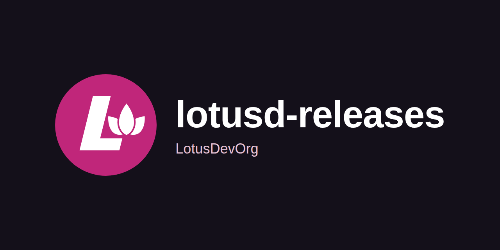

<p align="center"></p>

# Lotus node (lotusd): releases

[](https://status.givelotus.org)
[](https://status.givelotus.org)
[](https://github.com/LotusDevOrg/lotusd-releases/releases/latest)
[](https://status.givelotus.org)

Binaries of the Lotus software built by LotusDevOrg: the node `lotusd` and
its tools, the GPU miner, Lotus Desktop and, from 12.5.10, the Lotus phone
app for Android.

**Download the latest version: [Releases → Latest](https://github.com/LotusDevOrg/lotusd-releases/releases/latest)**

This repository holds releases only: the downloads, their checksums and
the release notes. It has no source code. Live state of the network
(nodes, mining, wallets, downloads): [status.givelotus.org](https://status.givelotus.org).

> **Operators and miners: run 12.5.10 or later before 2026-12-21 20:50
> UTC.** That is when the Napoleon network upgrade activates new consensus
> rules on mainnet (median time past of the previous block at or after
> 1797886200). The minimum was 12.5.8; it is now **12.5.10**, because
> 12.5.10 adds rules that activate with Napoleon (a price for on-chain
> data, a fee floor of 1 satoshi per byte, shorter merged-mining proofs,
> the contract extensions, child chain records). 12.5.8 and 12.5.9 do not
> follow the chain after the fork, and neither does any older version.
> Until then 12.5.10 accepts the same blocks as 12.5.9, so you can upgrade
> now: the data directory of 12.5.9 is used as it is. Coming from 12.5.8 or
> older, the first start converts the block files into one database (a few
> minutes, about 6.3 GB of free disk). Update Lotus Desktop and the phone
> app too: their light node must know the new rules. A fleet that announces
> `-upgradenotice=12.5.9,1797886200` changes it to
> `-upgradenotice=12.5.10,1797886200`. The notes of each release say what
> changes and what to do. Upgrade guide:
> [lotusia.network/upgrades](https://lotusia.network/upgrades/).

> **Merged-mining pools, from Napoleon:** Litecoin pools that already
> merge-mine Lotus with standard AuxPoW need no change. SHA-256d pools
> (eCash, Bitcoin, Bitcoin Cash) name their chain in one place:
> `createauxblock <address> xec|btc|bch`, or `-auxpowalgo=<chain>` on the
> Lotus node. From Napoleon a merged-mining proof is in a short form (at
> most 4,000 bytes, 32,000 for an anchor proof): a 12.5.10 node converts
> what `submitauxblock` and `getauxblock` are given; software that builds
> its own proofs must send the short form. Details:
> [lotusia.network/napoleon](https://lotusia.network/napoleon/#pools).

## What a release contains

Every file is named `<name>-<version>-<os>-<arch>` (`.tar.gz`, `.zip` for
Windows and for Lotus Desktop on macOS). `SHA256SUMS` lists them all.

| | Linux x86_64 | Windows x86_64 | macOS |
|---|---|---|---|
| Node: `lotusd` | yes | yes | Intel (x86_64) |
| Tools: `lotus-cli`, `lotus-tx` | yes | yes | Intel (x86_64) |
| `lotus-seeder` | yes | no | Intel (x86_64) |
| All of the above in one archive: `lotus-binaries` | yes | yes | Intel (x86_64) |
| GPU miner: `lotus-gpu-miner` | yes | no | no |
| Desktop app: `lotus-desktop` (mining, wallet, RANK) | yes | yes | Intel, Apple Silicon and universal |

The Lotus phone app (from 12.5.10):

| | File |
|---|---|
| Android 9 or later | `lotus-mobile-<version>-android.apk`, with its `.sha256`: signed by the owner and added to the release page shortly after publication |
| Android, as built by CI | `lotus-mobile-<version>-android-unsigned.apk`: Android does not install it; it is there to compare the signed file with the build |
| iOS | no file: build it from source on a Mac. There is no App Store or TestFlight build yet |

The app is not on Google Play yet.

Container images of the same version are on GitHub's registry:
`ghcr.io/lotusdevorg/lotusd` (node), `lotus-cli`, `lotus-tx`,
`lotus-seeder` and `lotus-gpu-miner`, each tagged with the version, with
its `X.Y` line and with `latest`.

## Install

Replace `12.5.10` with the version you want. The release page lists every
file with its size and checksum.

### Linux

```sh
V=12.5.10
BASE=https://github.com/LotusDevOrg/lotusd-releases/releases/download/v$V
curl -fsSLO $BASE/SHA256SUMS
curl -fsSLO $BASE/lotus-binaries-$V-linux-x86_64.tar.gz
sha256sum -c --ignore-missing SHA256SUMS     # must print: OK
tar -xzf lotus-binaries-$V-linux-x86_64.tar.gz
./lotus-binaries-$V-linux-x86_64/lotusd -version
```

Copy the binaries where you keep them (for example `/usr/local/bin`) and
start `lotusd`. Its data directory is `~/.lotus` unless you pass
`-datadir`; `lotusd -help` lists every option.

### macOS

The same steps with `lotus-binaries-$V-macos-x86_64.tar.gz`; check with
`shasum -a 256 -c --ignore-missing SHA256SUMS`. The binaries are built for
Intel Macs and are not notarised by Apple: macOS asks for confirmation
before the first launch.

### Windows

Download `lotus-binaries-<version>-windows-x86_64.zip` and `SHA256SUMS`
from the release page. In PowerShell,
`Get-FileHash .\lotus-binaries-<version>-windows-x86_64.zip -Algorithm SHA256`
must give the value on that file's line in `SHA256SUMS`. Then unzip.

### Docker

```sh
docker pull ghcr.io/lotusdevorg/lotusd:12.5.10
```

Pull a version, not only `latest`, so that an upgrade is something you
decide. The release notes give the image digests; pulling by digest
(`ghcr.io/lotusdevorg/lotusd@sha256:...`) pins the exact image.

### Android phone

Download `lotus-mobile-<version>-android.apk` and its `.sha256` from the
release page (not the `-unsigned` file), check it, and open it on the
phone (Android asks you to allow installs from that source):

```sh
V=12.5.10
BASE=https://github.com/LotusDevOrg/lotusd-releases/releases/download/v$V
curl -fsSLO $BASE/lotus-mobile-$V-android.apk
curl -fsSLO $BASE/lotus-mobile-$V-android.apk.sha256
sha256sum -c lotus-mobile-$V-android.apk.sha256   # must print: OK
apksigner verify --print-certs lotus-mobile-$V-android.apk   # optional, Android SDK build-tools
```

The signed APK is added after the release is published: if it is not on
the page yet, wait for it. The app opens on mainnet. Write down the
recovery words when the app shows them.

### iPhone

There is no download. The iOS app is built from the source on a Mac with
Xcode 15 or later, rustup and XcodeGen; it has fewer screens than the
Android app and does not run its light node yet.

## Upgrade

1. Read the notes of the release, and of every release between yours and
   it: they say when a version needs a reindex or changes a default.
2. Back up `wallet.dat`.
3. Stop the node and wait until it has exited (`lotus-cli stop`; with
   Docker, give it time: `docker compose stop -t 120`).
4. Replace the binaries, or change the image tag.
5. Start it and check the version it reports (`lotusd -version`,
   `lotus-cli getnetworkinfo`).

The data directory is kept as it is. Going back to an older version is
not always possible once a newer one has written to it; the notes say
when it is not.

## Checksums and signatures

- **`SHA256SUMS`** lists the SHA-256 of every file of the release. It is
  produced by the same automated build that produces the files, and a
  release is published only after what GitHub holds has been compared with
  what was built. Always check your download against it.
- **`SHA256SUMS` is signed with minisign** (from 12.5.7). Key id
  `1E3284B771C34644`, public key:

      RWRERsNxt4QyHm1O5elUVYPfnF0CR8tw73YTpRRri9Y2PUvTzIGkmSlY

  ```sh
  minisign -Vm SHA256SUMS -P RWRERsNxt4QyHm1O5elUVYPfnF0CR8tw73YTpRRri9Y2PUvTzIGkmSlY
  ```

  The key is kept offline and the signature is made after the release is
  published, so `SHA256SUMS.minisig` appears on the page a little after
  the other files. Lotus Desktop updates itself only once it is there.
- **The Android app** is signed with the owner's Android key, offline,
  after publication. The signed APK is not in `SHA256SUMS` (it did not
  exist yet when that file was signed): check it with its own `.sha256`
  and its certificate (`apksigner verify --print-certs`).
- The node binaries carry no code signature. Download from
  `github.com/LotusDevOrg/lotusd-releases` over HTTPS and nowhere else. A
  Lotus binary offered on another site, with or without a checksum beside
  it, is not ours.
- Lotus Desktop is signed for Windows and macOS when a release says so in
  its notes. Otherwise it is unsigned (ad-hoc signed on macOS) and the
  system asks for confirmation on first launch.
- Container images: the digest in the release notes identifies the image
  exactly. Compare it with
  `docker image inspect --format '{{index .RepoDigests 0}}' <image>`.
- A change of signing key is announced here and in the release notes.
  Nothing else is an announcement of a key.

## Third-party data

From 12.5.2 the node embeds an IP-to-country and IP-to-ASN table for the
peer flags of its web UI: DB-IP "IP to Country Lite" and "IP to ASN Lite"
([db-ip.com](https://db-ip.com)), licensed CC BY 4.0. The lookup runs inside
the node; no address is sent anywhere.

## Links

- Releases: https://github.com/LotusDevOrg/lotusd-releases/releases
- Container images: https://github.com/orgs/LotusDevOrg/packages
- A problem with a download or an install: open an issue on this repository.
